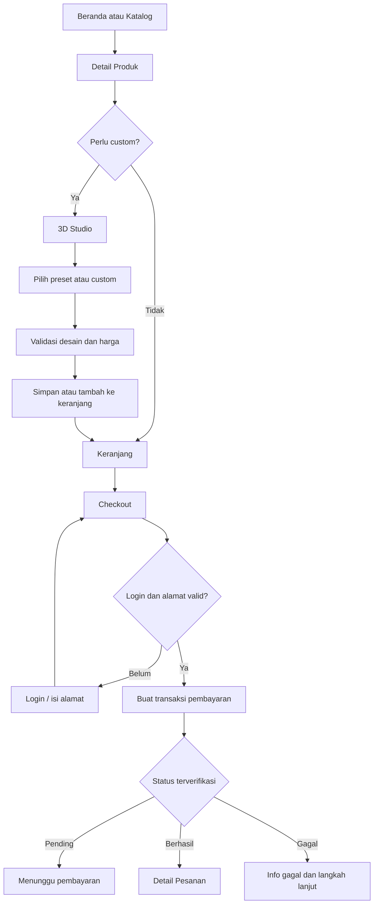

# User Flow Pembeli dan Checkout

## Alur utama

## Aturan transisi

- Bila pembeli masuk dari katalog berfilter, Back dari detail kembali ke filter yang sama.
- Dari Studio, Back ketika unsaved changes menawarkan Simpan, Buang, Batal.
- Masuk login dari checkout menyimpan konteks checkout jika memungkinkan dan aman.
- Total item dihitung ulang saat checkout, perubahan harga/stok disampaikan secara jelas.
- Setelah redirect payment, status tampilan harus merujuk ke hasil verifikasi server; tidak boleh membuat order duplikat karena refresh.

## Pengguna guest

Jika browsing dan custom sebagai guest diizinkan, jelaskan kapan login diperlukan. Rekomendasi awal: browsing, katalog, dan preview Studio dapat diakses tanpa login. Simpan ke akun/checkout dapat meminta login, dengan mekanisme mempertahankan konfigurasi sesi selama transisi.

## Kesalahan kritis

1. **Tidak ada model 3D:** tawarkan foto dan produk lain; jangan berpura-pura custom aktif.
2. **Placement invalid:** kembalikan posisi valid, beri hint yang spesifik.
3. **Stok berubah:** jangan kehilangan desain; tawarkan revisi komponen.
4. **Harga berubah:** tampilkan selisih dan persetujuan.
5. **Payment pending:** tampilkan status sementara dan instruksi.
6. **Payment webhook terlambat:** tampilkan menunggu pemeriksaan.
7. **Connection lost:** cegah duplikasi submit dan pertahankan isian penting.

## Produk stiker vs perangkat preview

Pada detail, Studio, cart, dan checkout, gunakan label seperti “Stiker custom untuk casing HP” serta keterangan “Model HP hanya pratinjau”; jika casing benar-benar dijual terpisah, ia memiliki item dan harga eksplisit tersendiri. Prinsip sama berlaku tablet, MacBook, dan botol.

## Kriteria selesai

- Seluruh alur dari katalog sampai order sukses dapat diselesaikan di mobile.
- User bisa keluar/masuk Studio tanpa kehilangan konfigurasi yang telah disimpan.
- User memahami perbedaan pembayaran berhasil, pending, dan gagal.
- Order detail punya thumbnail final dan item fisik yang benar.
