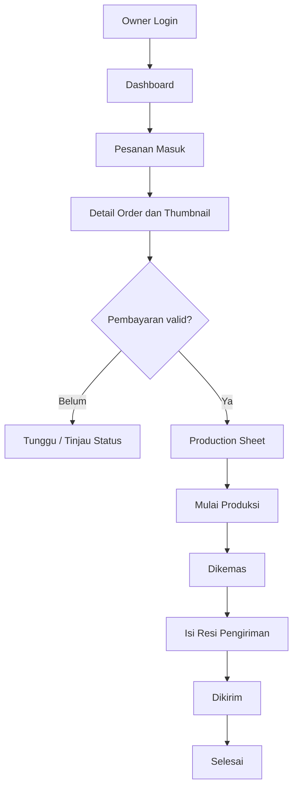

# User Flow Owner dan Operasional Produksi

## Proses order

## Aturan UI owner

- Status pembayaran dan produksi adalah dua entitas visual berbeda.
- Prioritaskan order yang membutuhkan tindakan, namun tetap sediakan semua status.
- Tampilkan desain final read-only, bukan editor yang dapat mengubah permintaan tanpa jejak.
- Komponen produksi selalu berisi nama, ukuran, bahan, jumlah, warna, posisi, layer, dan artwork jika stiker.
- Aksi “Mulai Produksi”, “Dikemas”, “Dikirim” hanya tampil pada state yang valid.
- Perubahan state menunjukkan tanggal/waktu dan pengguna yang mengubah bila sistem mendukung audit trail.

## Alur tambah produk custom

`Produk → Tambah → Info Produk → Varian & Harga → Komponen → Aset/Anchor/Surface → Preset → Preview → Draft/Publikasikan`

Jika aset belum valid, produk dapat disimpan draft namun tidak boleh dipublikasikan sebagai Studio 3D yang berfungsi.

## Manajemen aset

Manajemen GLB, UV, rig, anchor, dan tekstur membutuhkan UI jelas tetapi operasi presisi disarankan di desktop. Owner lewat HP dapat melihat status aset, thumbnail, dan validitas model tanpa memuat semua GLB bersamaan.

## Kebijakan fallback dan exception

- Thumbnail 3D gagal: production sheet tetap tersedia.
- Art cetak tidak resolusi cukup: blok publikasi stiker custom atau tampil warning yang memerlukan tindak lanjut.
- Pesanan dibayar lalu stok tidak cukup: tandai pengecualian dan tentukan solusi komunikasi; jangan hapus pesanan diam-diam.
- Webhook tidak pasti: label pembayaran “Perlu Verifikasi” berdasarkan data gateway, bukan manual override tanpa kontrol.

## Uji tugas owner

- Temukan order yang perlu diproses dari dashboard dalam beberapa tap.
- Sebutkan dua komponen dari production sheet tanpa memperbesar gambar.
- Buka preview final tanpa memuat model lain.
- Catat resi, periksa perubahan status pada detail customer.
- Filter transaksi gagal vs pending tanpa salah tafsir.
