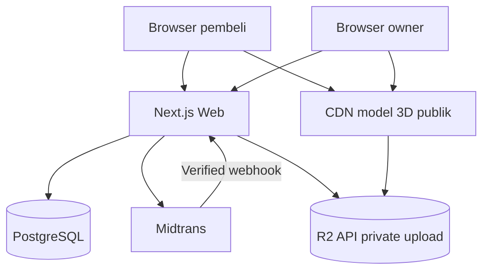

# Diagram Arsitektur dan Aliran Data

> Proyek: KWU Digital Atelier | Baseline: 20 Oktober 2026 | Status: spesifikasi teknis, bukan implementasi

## Context diagram

## Alur Studio → keranjang
1. GET product/variant/manifest/rules dari server; gambar poster tampil saat loading.
2. Client import bundle scene tipe yang dipilih; runtime mengambil GLB lewat CDN.
3. Buyer memilih preset, drag charm/decal; editor menyimpan state terstruktur dan mendeteksi benturan/area invalid.
4. Save draft mengirim schema-versioned configuration ke backend, setelah autentikasi. Server validasi jenis, komponen yang ada, kompatibilitas, aturan anchor, dan kepemilikan.
5. `Add to cart` mengirim ID produk, varian, dan konfigurasi; server menghasilkan quote harga terkini dan item cart.
6. Checkout memvalidasi ulang semua item serta stok, membuat order immutable snapshot dan pembayaran pending.
7. PSP mengirim webhook; backend verifikasi signature + status + nominal, transisi pembayaran idempotent.
8. Owner menerima production specification dari snapshot, bukan membaca state React yang bisa berubah.

## Batas data menurut trust level
- Trustless: body HTTP, local storage, drag coordinates, callback payment browser, token file upload.
- Partly trusted: manifest publik versioned; harus dicek integritas dan kompatibilitas.
- Server authoritative: price rules, stok, order state, customer ownership, payment verification.

## Event penting
`DESIGN_UPDATED` (client-only), `DESIGN_SAVED`, `CART_ITEM_ADDED`, `ORDER_CREATED`, `PAYMENT_CONFIRMED`, `STOCK_RESERVED`, `PRODUCTION_STARTED`, `SHIPMENT_DISPATCHED`. Gunakan tabel outbox jika proses lintas layanan nanti diperlukan, tidak wajib MVP.

## Konsistensi dan kegagalan
Jika upload thumbnail gagal, desain JSON tetap boleh tersimpan dengan status preview pending; jika payment webhook terlambat, order tetap pending dan UI menyediakan refresh/check status. Jangan mengubah pending menjadi paid hanya karena user kembali dari halaman PSP.
