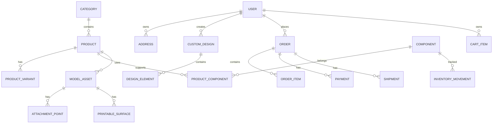

# ERD Konseptual dan Integritas Relasi

> Proyek: KWU Digital Atelier | Baseline: 20 Oktober 2026 | Status: spesifikasi teknis, bukan implementasi

## Tabel primer
`User`, `Session`/adapter auth, `Address`, `Category`, `Product`, `ProductVariant`, `Component`, `ProductComponent`, `ModelAsset`, `AttachmentPoint`, `PrintableSurface`, `Preset`, `CustomDesign`, `DesignElement`, `CartItem`, `Order`, `OrderItem`, `Payment`, `PaymentEvent`, `StockItem`, `InventoryMovement`, `Shipment`, `ProductionTask`, `AuditEvent`.

## Constraints penting
- FK semua user/design/order; unique SKU, unique payment provider transaction ID, unique webhook event hash/idempotency key.
- `role IN (BUYER, OWNER)`, status enum, uang integer IDR atau numeric Decimal, jumlah >= 0, sizeMm > 0.
- Unique partial/normalized keys bila dipakai untuk active carts. `OrderItem` menyimpan snapshot JSON + canonical pricing fields.
- `PaymentEvent` append-only; `Order` berelasi ke payment attempts. Jangan update hanya satu boolean `isPaid` tanpa riwayat.
- `InventoryMovement` berisi delta, reason, actor, source event untuk audit.
- Tombol delete produk terjual harus soft archive agar FK order historis tidak rusak.

## Indeks awal
`Product(categoryId,status,createdAt)`, `Order(userId,createdAt DESC)`, `Order(status,createdAt DESC)`, `Payment(orderId,status)`, `Design(userId,updatedAt DESC)`, `Inventory(stockItemId,createdAt DESC)`.

## Operasional
Migration commit di repo dan dijalankan terkontrol. Backup dan uji restore sebelum production. Jangan gunakan `db push` sebagai pengganti migration history untuk production.
